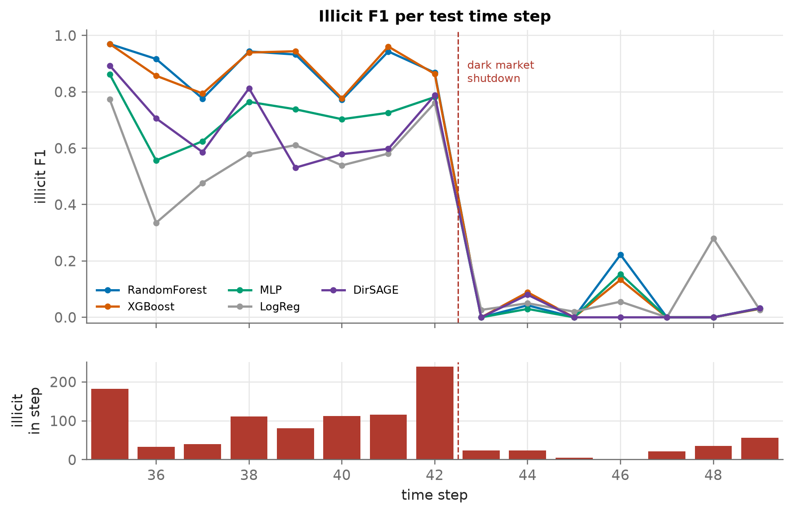

# Detecting Illicit Bitcoin Transactions

A comparative study of supervised, graph and unsupervised methods on the
[Elliptic Data Set](https://www.kaggle.com/datasets/ellipticco/elliptic-data-set):
203,769 real Bitcoin transactions over 49 time steps, linked by 234,355 payment flows.

EE418 final project, International University of Sarajevo, 2026. Anes Berbić.

**Deliverables:** [report (PDF, 8 pages)](report/main.pdf) ·
[slides (PDF)](slides/slides.pdf) · code and results in this repository.



## Research question

> Can we tell illicit Bitcoin transactions apart from licit ones, using their
> features and their position in the transaction graph?

## Findings

1. **The published baselines reproduce.** Random Forest on all features:
   F1 0.810 ± 0.005 (five seeds) vs 0.788 in Weber et al. (2019). [E1]
2. **Random Forest and XGBoost are tied** (F1 0.804 vs 0.794, paired bootstrap
   p = 0.50); both beat the MLP (0.679) and logistic regression (0.515),
   p < 0.001. The 95% interval for F1 is about 0.27 wide, because the test
   period is 15 time steps, not 16,670 independent rows. [E2]
3. **Re-balancing barely matters.** SMOTE and class weights move the tree
   models' PR-AUC by about one point. Threshold tuning helps weak models, but the
   best threshold drifts over time. [E3]
4. **The graph helps, mostly through its simplest summary.** Neighbour-aggregated
   features add +0.06 F1 (p < 0.001). Structural features and GNN embeddings add
   at most 0.02 F1 and no PR-AUC. A directed GNN (DirSAGE, ours) beats GCN by
   0.15 F1 but stays below the trees. [E4]
5. **A better GNN makes a worse hybrid.** DirSAGE embeddings *lower* tree F1 by
   0.12: the GNN memorises its training labels (train PR-AUC 0.9999) and the
   forest puts 99.8% of its importance on them. [E5, E5b]
6. **Crime is typical, not anomalous.** Isolation Forest ranks worse than random
   (ROC-AUC 0.17). Flagging the most *typical* transactions gives PR-AUC 0.475
   with no labels; XGBoost needs about 60 labels to beat that. [E6]
7. **Why every model fails after the dark market shutdown (step 43).** Afterwards,
   90% of illicit transactions are closer to licit than to known illicit ones
   (31% before); 72% of features shift for illicit transactions vs 7% for licit.
   Retraining before every step lifts post-shutdown F1 only from 0.04 to 0.19.
   Five anonymised features are hidden clocks (|ρ| > 0.95 with time). [E7]
8. **The model relies on local features.** Shuffling them costs 0.69 PR-AUC; the
   aggregated ones 0.06; structural graph features almost nothing. [E8]

## Main results (test steps 35–49, mean of five seeds)

| Model         | F1    | F1 95% CI      | PR-AUC | PR-AUC 95% CI  | Recall@100/step |
|:--------------|------:|:---------------|-------:|:---------------|----------------:|
| Random Forest | 0.804 | [0.618, 0.888] | 0.793  | [0.576, 0.900] | 61%             |
| XGBoost       | 0.794 | [0.613, 0.886] | 0.798  | [0.586, 0.903] | 62%             |
| MLP           | 0.679 | [0.481, 0.750] | 0.605  | [0.425, 0.763] | 57%             |
| Logistic Reg. | 0.515 | [0.328, 0.626] | 0.319  | [0.173, 0.443] | 39%             |

CIs resample whole time steps (block bootstrap). Recall@100/step: share of all
illicit test transactions found if an analyst reviews the top 100 of each step.
Every table is in [`reports/tables/`](reports/tables) as CSV, Markdown and LaTeX.

## Evaluation protocol

| Risk | Guard |
|:--|:--|
| Training on the future | Temporal split of the paper: steps 1–34 train, 35–49 test |
| Tuning on the test set | Expanding-window folds inside steps 1–34 choose hyper-parameters and the threshold |
| Time as a feature | Time step dropped (keeping it cut logistic regression's F1 from 0.51 to 0.36) |
| Preprocessing leakage | Scaling and SMOTE live inside the pipeline; graph features never use labels |
| Seed luck | Every model × 5 seeds |
| False precision | Block-bootstrap CIs over time steps; paired bootstrap tests between models |
| Silent bugs | Unit tests assert that no test or future step reaches training |

## Experiments

| Script | Question | Output |
|:--|:--|:--|
| [`e00_eda.py`](experiments/e00_eda.py) | What does the data look like? | labels over time, correlation, PCA, degree, homophily |
| [`e01_reproduce.py`](experiments/e01_reproduce.py) | Do we match Weber et al.? | paper vs ours |
| [`e02_models.py`](experiments/e02_models.py) | Which model is best under a fair protocol? | main table, paired tests |
| [`e03_imbalance.py`](experiments/e03_imbalance.py) | Class weights vs SMOTE vs threshold tuning | 4 models × 3 strategies × 2 thresholds |
| [`e04_graph.py`](experiments/e04_graph.py) | Does the graph help? | GCN, Skip-GCN, DirSAGE; LF/AF/+G/+NE |
| [`e05_hybrid.py`](experiments/e05_hybrid.py) | Hybrid with the best GNN | trees + DirSAGE embeddings |
| [`e05b_memorisation.py`](experiments/e05b_memorisation.py) | Why does that hybrid fail? | train vs test separability |
| [`e06_unsupervised.py`](experiments/e06_unsupervised.py) | Without labels? How many labels are needed? | Isolation Forest, label-efficiency curve |
| [`e07_drift.py`](experiments/e07_drift.py) | Why does performance collapse over time? | per-step F1, novelty, KS shift, walk-forward, hidden clocks |
| [`e08_explain.py`](experiments/e08_explain.py) | What did the model learn? | SHAP, group permutation importance |

## Reproduce

Requires [uv](https://docs.astral.sh/uv/) and, for the PDFs,
[tectonic](https://tectonic-typesetting.github.io/) (`brew install tectonic`).

```bash
uv sync                       # Python 3.12 + pinned dependencies
# put the three Kaggle CSVs in data/raw/ (see data/README.md)
make test                     # unit and leakage tests
make all                      # every experiment, about 3-4 hours on an Apple M4
make report slides            # regenerate numbers.tex and compile both PDFs
```

Each experiment writes `results/<name>.json`, test-set scores to
`results/scores/`, figures to `reports/figures/` and tables to
`reports/tables/`. `report/build_numbers.py` turns the result files into LaTeX
macros, so the report and the slides quote results without hand-typed numbers.

**macOS note.** xgboost and PyTorch ship different OpenMP runtimes; loading both
in one process crashes unless xgboost is imported first and PyTorch runs on one
CPU thread. `src/elliptic/__init__.py` does both. GNNs train on the Apple GPU
(MPS) when available.

## Layout

```
src/elliptic/      data loading, split, graph features, models, GNNs, evaluation, plotting
experiments/       one script per question (E0-E8)
tests/             data sanity, leakage guards, graph features, GNNs, metrics
results/           JSON results and test-set scores (parquet)
reports/           figures (PNG + PDF) and tables (CSV, Markdown, LaTeX)
report/            the written report (LaTeX) and its compiled PDF
slides/            the final presentation (Beamer) and its compiled PDF
```

## References

- Weber, M. et al. (2019). *Anti-Money Laundering in Bitcoin: Experimenting with
  Graph Convolutional Networks for Financial Forensics.* KDD Workshop on Anomaly
  Detection in Finance. [arXiv:1908.02591](https://arxiv.org/abs/1908.02591)
- Elmougy, Y. & Liu, L. (2023). *Demystifying Fraudulent Transactions and Illicit
  Nodes in the Bitcoin Network for Financial Forensics.* KDD.
  [arXiv:2306.06108](https://arxiv.org/abs/2306.06108)
- Full bibliography in the [report](report/main.pdf).
